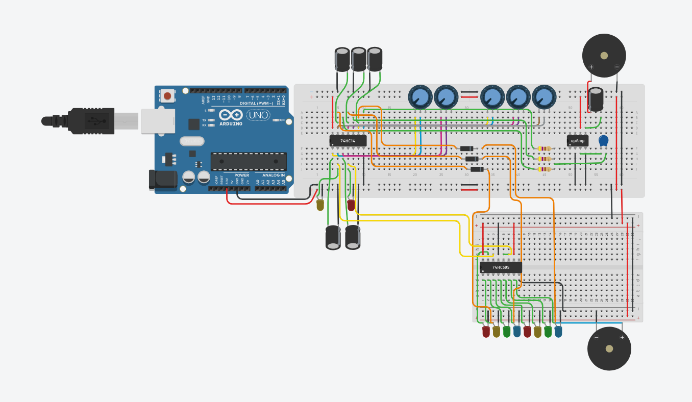

# Synthesizer-PCB : Breadboard to Solder to KiCad

> A hand-built digital/analog audio synthesizer made of Schmitt-trigger oscillators, a shift register that lights up LEDs, and an op-amp driving a buzzer. Prototyped on breadboard, simulated in TinkerCAD, soldered onto a permanent board, and redesigned in KiCad.

**Team:** Carolyn Haase and Thomas Bellion Masson
**Date:** November 2026

🔊 **Listen:** [Demo audio of the final synth](images/PCB_Video.mp4)

---

## 1. Overview

This project is a small experimental synthesizer that produces a series of electronic **beeps** while a row of LEDs lights up in sync with the sound. Several oscillators generate tones at different frequencies, which are mixed together, amplified, and sent to a buzzer. In parallel, a shift register drives eight LEDs so that the sound can be *seen* as well as heard.

Five potentiometers let the player change the character of the sound in real time (pitch and rhythm of the beeps).

**Key features (V1):**
- Several relaxation oscillators built around a **74HC14N** Schmitt-trigger inverter
- **74HC595** shift register driving a row of 8 LEDs, which blink in time with the beeps
- Diode-based mixing of the oscillator signals
- **Op-amp** output stage driving a buzzer
- Five **B10K potentiometers** to tune the sound live
- Slight crackle in the sound (A lo-fi effect we couldn't figure out the source of.) 
 
--- 

## 2. How It Works

The circuit is powered at 5 V (supplied through an Arduino Uno used purely as a power source on the breadboard version) and is made of three cooperating blocks.

### Block diagram

### Circuit description

1. **Oscillators (74HC14N).** The 74HC14 contains six inverters with Schmitt-trigger inputs. By feeding the output of an inverter back to its input through a resistor and a capacitor, it becomes a simple oscillator: the capacitor charges and discharges through the resistor, and the inverter flips its output each time a threshold is crossed. The result is a square wave. Changing the resistance with a potentiometer changes how fast the capacitor charges, and therefore the pitch or the rhythm.
2. **Mixing and amplification (diodes, resistors, op-amp).** The signals from the different oscillators are combined through diodes and 470 Ω resistors, then sent to an op-amp stage that boosts the signal enough to drive a buzzer. 10 µF capacitors smooth and couple the signal.
3. **Visual feedback (74HC595).** The 74HC595 is a serial-in, parallel-out shift register. Driven by the oscillator signals, it shifts bits along its eight outputs, so the connected LEDs light up in changing patterns, in sync with the beeps.

---

## 3. Bill of Materials

| Qty | Component | Value / Part # | Purpose |
|-----|-----------|----------------|---------|
| 1 | Hex Schmitt-trigger inverter | 74HC14N | Oscillators |
| 1 | Shift register | 74HC595 | LED driver |
| 1 | Operational amplifier | [part number, e.g. LM358 / TL072] | Output amplification |
| 5 | Potentiometer | B10K (linear, 10 kΩ) | Live control of the sound |
| 5 | Electrolytic capacitor | 10 µF, 25 V | Oscillator timing and coupling |
| 1 | Electrolytic capacitor | 220 µF, 25 V | Amplification |
| 1 | Electrolytic capacitor | 220 nF, 25 V | Amplification |
| 3 | Resistor | 470 Ω | Mixing / current limiting |
| 3 | Diode | [e.g. 1N4148] | Signal mixing |
| 10 | LED | [colors] | Visual feedback |
| 1 (soldered) / 2 (TinkerCAD) | Buzzer | Piezo buzzer | Sound output |
| 1 | Arduino Uno (breadboard version only) | | 5 V power source |

---

## 4. Phase 1: Breadboard Prototypes

The final circuit we built and tested.

**What we learned:** [Short notes, issues, fixes.]

---

## 5. Phase 2: Hand-Drawn Circuits and Oscilloscope Captures

### Hand-drawn schematics

 

### Oscilloscope screenshots

---

## 6. Phase 3: TinkerCAD Diagram and Schematic

### Breadboard circuit diagram

The TinkerCAD version uses two breadboards: the first one holds the oscillator and mixing stage (74HC14, five potentiometers, diodes, resistors, op-amp, buzzer), and the second one holds the 74HC595 with its row of eight LEDs and a second buzzer.

---

## 7. Phase 4: Soldered Synth

### Photographs

| Back (solder side) | Front |
|--------------------|----------|
| .jpeg) | .jpeg) |

### Proof of functioning

The soldered synth behaves exactly like the breadboard and TinkerCAD versions: it plays a sequence of beeps while selected LEDs light up. The only difference is that the soldered version has **a single buzzer**, whereas the TinkerCAD model shows two (we only had one spare for the final board). Everything else works the same way. The sound has a slight crackle, but it remains clean enough to enjoy.

- 🎥 **Video demo:** [soldered_demo.mp4](images/PCB_Video.mp4)

### Soldering notes

Soldering was challenging: with so many wires and so little space, it required intense concentration to keep track of every connection and make sure no wire or pin was missed. It was exhausting, but the board worked on the first attempt.

---

## 8. Phase 5: KiCad 

[Describe]

### V2 schematic

### V2 PCB layout (real dimensions and components)

### 3D view

---

## 9. Challenges and Lessons Learned

Whenever the circuit did not work, we lost a lot of time checking complicated things (signal behavior, theory, component values), when the real cause was much simpler: **a wire plugged into the wrong pin, or a faulty component.**

**What we take away from this project:**

- 🔍 **Test your components before using them.** A defective part can look like a design mistake.
- 📖 **Read the datasheets carefully**, even if it means going back to them several times. Pin numbering and orientation of ICs like the 74HC14N and 74HC595 are easy to get wrong.
- ✅ **Check the simple things first** (power, ground, pin placement, polarity of capacitors and diodes) before suspecting the design.

---

## 10. Team Contributions

| Member | Contributions |
|--------|---------------|
| Carolyn Haase | [e.g. oscilloscope measurements, KiCad, Breadboard circuits, ...] |
| Thomas Bellion Masson | [e.g. Soldering, Breadboard circuits, TinkerCAD, ...] |

